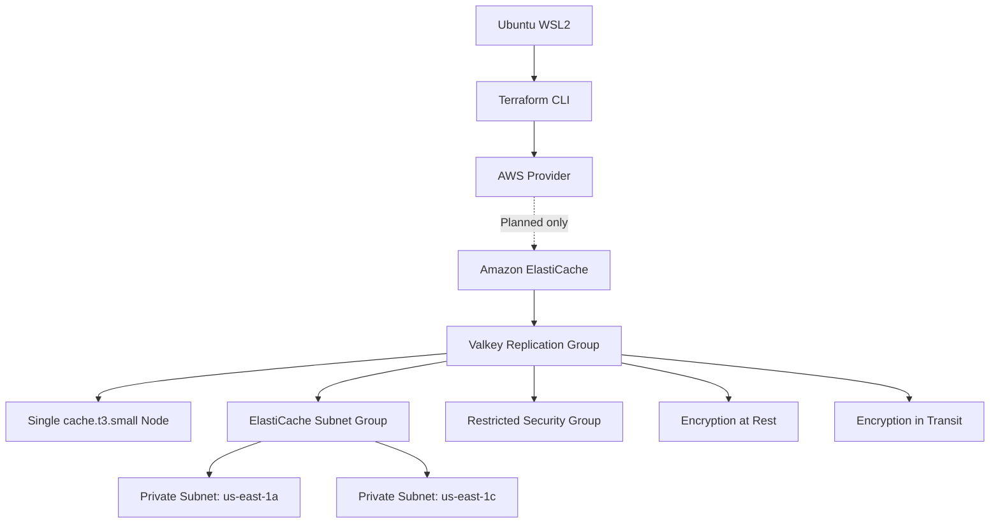
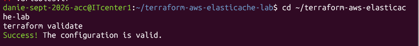

# Amazon ElastiCache Valkey — Terraform Infrastructure Lab

## Project Status

**PLANNING ONLY — NOT DEPLOYED**

This project demonstrates how to use Terraform to define
Amazon ElastiCache infrastructure in AWS.

Terraform configuration was initialized, validated, and planned
successfully. No AWS cache resources were deployed.

## Technologies

- Ubuntu WSL2
- Terraform
- AWS CLI
- Amazon ElastiCache
- Valkey 8.0
- Amazon VPC
- Git and GitHub

## Planned Architecture



## Planned Infrastructure

| Resource | Configuration |
|---|---|
| AWS Region | us-east-1 |
| VPC | vpc-00e32019add7ce8fa |
| Engine | Valkey 8.0 |
| Cache Node Type | cache.t3.small |
| Cache Nodes | 1 |
| Automatic Failover | Disabled |
| Encryption at Rest | Enabled |
| Encryption in Transit | Enabled |
| Security Group Ingress | No rules |
| Security Group Egress | No rules |
| Deployment Status | Not deployed |

## Network Design

The planned cache uses two existing subnet candidates:

- subnet-02e4562134feeb8ae (us-east-1a)
- subnet-0113128309df4a78a (us-east-1c)

Both subnets were verified as available, with automatic
public IPv4 assignment disabled and local-only IPv4 routing.

No application connectivity has been configured.

## Terraform Validation

The following commands were successfully executed:

```bash
terraform init
terraform fmt
terraform validate
terraform plan -input=false -no-color
```

Actual Terraform plan result:

```text
Plan: 3 to add, 0 to change, 0 to destroy.
```

See [Validation Evidence](docs/validation-evidence.md)
for the recorded validation results.

## Security Considerations

- Security group has no inbound rules.
- Security group has no outbound rules.
- Encryption at rest is enabled.
- Encryption in transit is enabled.
- Valkey authentication and ACLs are not configured.
- Network ACLs and actual connectivity have not been tested.
- No secrets or Terraform state files should be committed.

This is a learning configuration, not a production-ready deployment.

## Cost Considerations

Amazon ElastiCache can incur ongoing charges when deployed.

This project was validated using Terraform planning only.

No terraform apply command was executed.

## Portfolio Evidence

Actual terminal screenshots will be stored in the
screenshots/ directory after validation evidence is captured.

## Future Improvements

- Configure Valkey authentication and access controls.
- Allow application access using narrowly scoped security group rules.
- Evaluate high availability and automatic failover.
- Add monitoring and logging.
- Evaluate deployment cost before provisioning.

## Actual Terraform Validation Screenshot



The screenshot shows actual Terraform validation and planning results.

**Deployment status:** PLANNING ONLY — NOT DEPLOYED.
